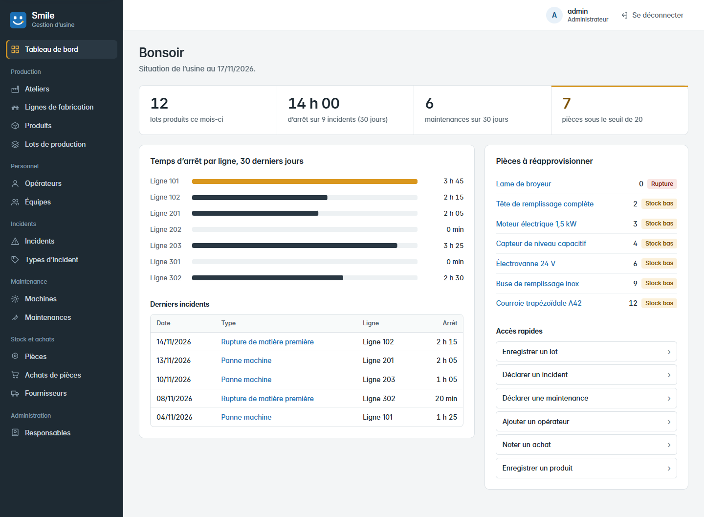
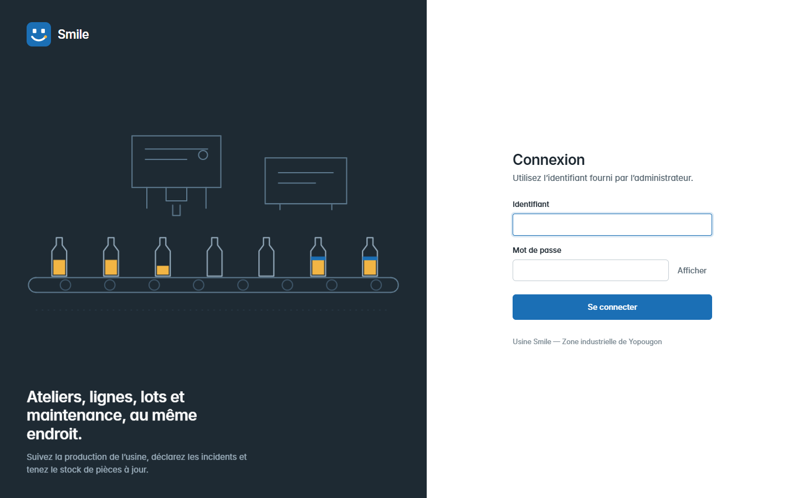
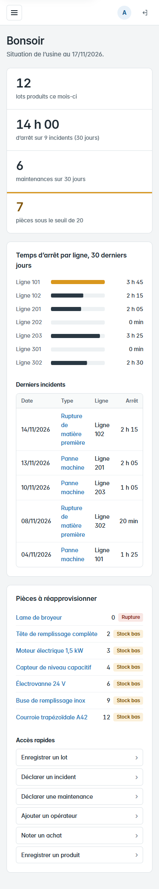

# Smile — logiciel de gestion d'usine

Application web PHP pour suivre la production d'une usine : ateliers, lignes de fabrication, produits, lots, opérateurs et équipes, incidents, machines et maintenances, stock de pièces, achats et fournisseurs. Les droits dépendent du rôle (administrateur, responsable des ateliers, collaborateur responsable, opérateur).

Projet Agile des logiciels, TWIN 3, ESATIC. Réalisé par Eboua Franck, sous la direction du Dr N'drin Hugues.



| Connexion | Mobile |
|---|---|
|  |  |

## Fonctionnalités

- Tableau de bord : lots du mois, temps d'arrêt par ligne, maintenances, pièces sous le seuil de stock
- Créer, consulter, modifier et supprimer dans chaque module, avec recherche, filtres et pagination (schéma MySQL de 22 tables)
- Règles métier et fiches détaillées : consommation de pièces, alertes de stock, incidents par lot, maintenances des machines
- Comptes par rôle, journal d'activité, blocage après 5 tentatives de connexion, déconnexion après inactivité
- Sécurité : requêtes préparées (PDO), jetons CSRF, mots de passe hachés, en-têtes CSP stricts, aucun script en ligne
- MySQL (XAMPP / WAMP) ou SQLite (démonstration hors ligne)

## Stack

PHP 8 (sans framework), PDO MySQL / SQLite, HTML, CSS et JavaScript natifs. Diagrammes UML (draw.io) dans `database/diagrammes/`.

## Lancer en local

Démonstration rapide avec SQLite, depuis ce dossier :

```bash
SMILE_DB_DRIVER=sqlite php -S localhost:8000
```

(Windows : `set SMILE_DB_DRIVER=sqlite` puis `php -S localhost:8000`.)

Ouvrir `http://localhost:8000/install.php`, choisir « Données de démonstration », puis se connecter. L'installation avec XAMPP et les comptes de démonstration sont décrits dans [LISEZ-MOI.md](LISEZ-MOI.md).

## Version 2 : interface, accessibilité et animation

- Mobile : le tableau de bord passe sur une colonne (il débordait horizontalement), champs en 16 px, cibles tactiles d'au moins 44 px
- Menu latéral mobile : `aria-expanded`, fermeture avec Échap, focus placé dans le menu puis rendu au bouton, menu retiré du parcours clavier quand il est fermé
- Lien « Aller au contenu principal » pour la navigation au clavier, focus plus visible
- Formulaires : bouton occupé pendant l'envoi (plus de double envoi), alerte « majuscules activées » sur le mot de passe
- Animations : entrée échelonnée des blocs, compteurs des indicateurs, barres de temps d'arrêt en `transform` (sans reflow), tiroir mobile avec courbes d'entrée et de sortie distinctes ; tout est coupé quand le système demande moins d'animations (`prefers-reduced-motion`)
